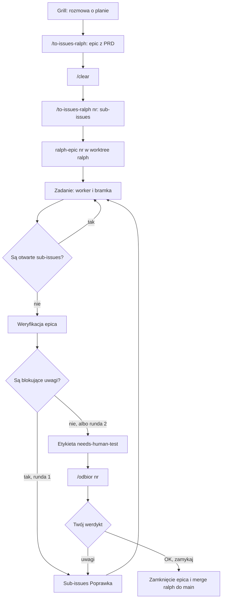

# ai-coding — skille i współdzielony Ralph

## Co to jest i po co

To zestaw narzędzi, dzięki któremu agent kodujący sam implementuje plan, a Ty tylko go układasz
i odbierasz gotową pracę. Plan ustalasz w rozmowie z Claude (tzw. **grill** — agent zadaje Ci
pytania, aż plan jest szczelny). Potem **Ralph** — pętla uruchamiana z terminala — sam, bez Twojego
udziału, realizuje zadania jedno po drugim, a na końcu zatrzymuje się i prosi Cię o odbiór.

Ralph jest jeden dla wszystkich repo, niezależnie od stacku. To, co zależy od repo (jak odpalić
testy, kiedy zadanie jest „gotowe”), siedzi w sekcji `## Ralph` w `CLAUDE.md` tego repo. Sekcję pisze
skill `/ralph-konfiguracja`, nie Ty. Ralph działa wyłącznie w Claude.

Praca jest podzielona na **epiki**. Epic to jedno większe zadanie: issue `[PRD]` na GitHubie
(**PRD** to opis tego, co ma powstać i po co), do którego należą mniejsze **sub-issues** (kawałki
pracy, każdy do zrobienia w jednym przebiegu pętli). Każda praca jest epikiem, nawet
jednolinijkowa zmiana — wtedy to epic z jednym sub-issue.

## Przepływ



Pętla ma wbudowany bezpiecznik: weryfikacja epica odbywa się **najwyżej dwa razy**. Po drugiej
rundzie epic idzie do Ciebie nawet z nierozwiązanymi uwagami — wylądują na początku listy odbioru.

### Co robisz Ty, a co robi Ralph

| Krok | Co robisz Ty | Co robi Ralph |
|------|--------------|---------------|
| 1. Grill | Rozmawiasz z Claude o planie i odpowiadasz na jego pytania. | Nic — to jeszcze nie pętla. |
| 2. `/to-issues-ralph` | Wołasz skill bez argumentu po skończonym grillu. | Uzupełnia PRD o ustalenia z grilla, publikuje epic (`[PRD]` ze scenariuszem „Jak odebrać”) i podaje jego numer. Rozbicia jeszcze nie robi. |
| 3. `/clear` | Czyścisz sesję, żeby rozbicie ruszyło ze świeżym kontekstem. | Nic. |
| 4. `/to-issues-ralph nr` | Wołasz skill z numerem epica. | Czyta PRD z epica i dzieli go na sub-issues. Każdemu nadaje złożoność (`normal` albo `heavy`), a `heavy` dostaje listę przypadków do przetestowania. |
| 5. `ralph-epic nr` | Odpalasz w worktree na gałęzi `ralph` (osobny katalog roboczy gita, żeby pętla nie ruszała Twojej pracy) i idziesz zająć się czymś innym. | Bierze sub-issues po kolei, jedno na przebieg, w świeżym kontekście. |
| 6. Zadanie z bramką | Nic. | **Worker** (model, który pisze kod) implementuje sub-issue, a potem skrypt uruchamia **bramkę** — komendę testów z linii `ralph-gate:` w `CLAUDE.md`. Zielona bramka = sub-issue zamknięte. Czerwona = wraca do kolejki. |
| 7. Weryfikacja epica | Nic. | Gdy wszystkie sub-issues są zamknięte, pętla uruchamia bramkę na całym epicu i **weryfikatora** (mocniejszy model, który tylko czyta). Blokujące uwagi w rundzie 1 zamieniają się w sub-issues „Poprawka”, które pętla sama robi. |
| 8. `needs-human-test` | Widzisz w terminalu „Epic #N gotowy do odbioru”. | Nakłada na epic etykietę `needs-human-test` (bezpiecznik: dopóki jest, pętla nie zaczyna nowej pracy) i dodaje komentarz z listą odbioru. |
| 9. `/odbior nr` | Wołasz skill, przechodzisz kroki w artefakcie, przy każdym klikasz OK albo „do poprawki”, wołasz `/odbior nr` jeszcze raz. | Pierwsze wołanie publikuje artefakt (stronę z krokami). Drugie czyta Twoje werdykty i działa: drobiazg poprawia od razu, większą sprawę zakłada jako sub-issue „Poprawka” (epic wraca do pętli). |
| 10. Zamknięcie | Przy samych „OK” mówisz „zamykaj”. | Claude w sesji robi doc-sync (uzgadnia README z tym, co weszło), scala `ralph` do `main` (`git merge --ff-only ralph`, lokalnie, bez pusha) i zamyka epic. |

Szczegółowy opis każdego etapu (kody wyjścia, weryfikator, dowody, lista odbioru): [docs/ralph-szczegoly.md](docs/ralph-szczegoly.md).

### Ralph stanął — co teraz

| Co widzisz | Co robisz |
|------------|-----------|
| Strażnik (`✋`) odmówił startu: brak sekcji `## Ralph` w `CLAUDE.md`. | Uruchom `/ralph-konfiguracja` w tym repo i odpal pętlę ponownie. |
| Brak linii `ralph-gate:` w `## Ralph` (błąd, kod 1). | Uruchom `/ralph-konfiguracja` — dopisze linię także do istniejącej sekcji. |
| Czerwona bramka za pierwszym razem. | Nic — sub-issue wraca do kolejki z komentarzem, a pętla jedzie dalej i poprawi. |
| Czerwona bramka drugi raz na tym samym sub-issue (kod 3). | Przeczytaj komentarz workera i log w `.git/ralph-logs/`, popraw przyczynę lub issue i uruchom pętlę ponownie. |
| Limit użycia (`⏸`, kod 8). | Jeśli reset jest w ciągu 6 h, pętla czeka sama. Dalej: po resecie wklej tę samą komendę, którą uruchomiono przebieg — wznowi przerwaną sesję. |
| „Epic #N gotowy do odbioru”. | Uruchom `cd <worktree> && claude "/odbior N"` i przejdź odbiór. |
| `ralph-epic` bez numeru odmawia, bo jakiś epic czeka na odbiór. | Odbierz ten epic (`/odbior nr`), albo uruchom `ralph-epic nr` z numerem innego epica — z numerem pętla pomija ten bezpiecznik. |
| Sub-issue czeka na Twoją decyzję (sesja HITL, czyli rozmowa z agentem zamiast pracy bez nadzoru). | Odpowiedz agentowi. Po rozstrzygnięciu sub-issue zamknij albo przywróć mu `ready-for-agent`, i odpal pętlę znowu. |

Kody wyjścia, pełna tabela zatrzymań `ralph-epic` i znaczenie symboli na ekranie:
[docs/ralph-szczegoly.md](docs/ralph-szczegoly.md).

## Instalacja

Dwa etapy: **raz globalnie** instalujesz to repo, a potem **raz na repo** włączasz w nim Ralpha.

### Etap 1 — raz, globalnie (instalacja `ai-coding`)

```bash
git clone <ai-coding> ~/projects/ai-coding
cd ~/projects/ai-coding
./install.sh
```

Instalator jest **samolokujący** (działa z dowolnego katalogu), **najpierw pyta o zgodę**
i **idempotentny** (ponowne uruchomienie nie psuje poprawnych symlinków). Tworzy:

- skille Claude → `~/.claude/skills`: `ralph-konfiguracja`, `to-issues-ralph`, `odbior` (tylko Claude)
- skille Codex → `${CODEX_HOME:-~/.codex}/skills`: te same nazwy, wołane w Codexie jako `$...`
- launchery → `~/.local/bin`: `ralph-once`, `ralph-once-local`, `ralph-epic`

Repo-local plugin Codex (`.agents/plugins/marketplace.json` + `.agents/plugins/plugins/ai-coding`)
jest częścią repo, instalator go nie tworzy — tylko wypisuje dwie komendy `codex plugin`, którymi
go włączasz.

Źródło zostaje w tym repo, a katalogi skills i `~/.local/bin` tylko linkują — `realpath` rozwija
symlink, więc skrypty Ralpha znajdują swoje prompty obok siebie. Repo projektowe **nie** zawiera
symlinka, więc po sklonowaniu Ralpha odpalasz globalnym launcherem. To robisz **tylko raz** —
nie powtarzasz `install.sh` w każdym repo.

> Launchery wymagają `~/.local/bin` w `PATH`.

Opcjonalnie, jeśli chcesz widzieć ai-coding jako plugin Codex:

```bash
codex plugin marketplace add ~/projects/ai-coding/.agents/plugins
codex plugin add ai-coding --marketplace ai-coding-local
```

### Etap 2 — raz na każde repo, w którym chcesz Ralpha

Repo bez Ralpha potrzebuje tylko sekcji `## Ralph` w swoim `CLAUDE.md` — inaczej
strażnik jest fail-closed i `ralph-once` od razu halt-uje. Sekcję pisze
`/ralph-konfiguracja` (w Claude):

```bash
cd ~/projects/repo-laravel            # repo nr 1 — stack PHP/Laravel, jeszcze bez Ralpha
# w sesji Claude: /ralph-konfiguracja
#   → wykrywa stack (composer test / pint), pisze ## Ralph do CLAUDE.md, tworzy labelki
ralph-once                            # pętla rusza, bo ## Ralph już jest

cd ~/projects/repo-expo               # repo nr 2 — stack RN/Expo, jeszcze bez Ralpha
# w sesji Claude: /ralph-konfiguracja
#   → wykrywa stack (npm typecheck/lint/test + needs-human-test), pisze ## Ralph, tworzy labelki
ralph-once
```

Ten sam globalny `ralph-once` obsłużył oba repo o różnych stackach — jedyna różnica siedzi
w sekcji `## Ralph` każdego z nich. `install.sh` z Etapu 1 nie był tu powtarzany.

## Komendy Ralpha

```bash
ralph-epic 12                      # cały epic #12, od startu do odbioru (zwykła droga)
ralph-once 224                     # jedno issue #224
ralph-once 12                      # 12 to epic → pierwsze wolne z jego sub-issues
ralph-once                         # pętla sama wybiera następne zadanie
ralph-once-local                   # zadania z lokalnych plików issues/*.md, nie z GitHuba
ralph-once 224 --force-model=opus  # Opus zamiast modelu dobranego do złożoności zadania
```

- `ralph-epic` powtarza `ralph-once` na kolejnych sub-issues, aż epic trafi do odbioru albo coś
  go zatrzyma. Zatrzymania opisuje tabela „Ralph stanął — co teraz” wyżej.
- Złożoność zadania (`complexity:normal` albo `complexity:heavy`, nadana przy rozbiciu) wybiera
  model workera; `heavy` dostaje dodatkowo przegląd mocniejszym modelem. Mapowanie i szczegóły:
  [docs/ralph-szczegoly.md](docs/ralph-szczegoly.md).
- Ralph pracuje bez nadzoru: `ready-for-agent` to etykieta „to zadanie może zrobić agent sam”
  (tryb **AFK**, away-from-keyboard). Zadanie bez niej to **HITL** (human-in-the-loop): potrzebuje
  Twojej decyzji i `ralph-once nr` otwiera dla niego rozmowę zamiast pracy w tle.
- Jeden Ralph na worktree: drugi przebieg w tym samym katalogu zapyta o przerwanie pierwszego.
  Równoległe przebiegi rób w osobnych worktree.
- Log każdego przebiegu leży w `.git/ralph-logs/`; gdy coś się psuje, powiedz agentowi „zobacz logi
  w `.git/ralph-logs/`”. Co jest na ekranie i w logach: [docs/ralph-szczegoly.md](docs/ralph-szczegoly.md).

Wokół pętli: **strażnik** (`ralph/preflight.sh`) przed każdym startem sprawdza, czy repo ma gotową
sekcję `## Ralph`, i bez niej zatrzymuje pętlę. **Bramka** to komenda z `ralph-gate:`, którą pętla sama
odpala po każdym zamkniętym sub-issue. Repo z osobną gałęzią produkcyjną może mieć gałąź per epic
(`ralph-base-branch`, opisana w szczegółach).

Design: `CONTEXT.md` (słownik), `docs/adr/0001` (warstwowy fallback `/podsumuj`),
`docs/adr/0002` (współdzielony Ralph: prompty agnostyczne + config w CLAUDE.md).

## Wyłączone skille

`zapisz`, `podsumuj`, `sesja` i `sesja-konfiguracja` nie są linkowane przez `install.sh` — przez
miesiąc nie było ani jednego wywołania, a opis każdego zlinkowanego skilla trafia do kontekstu
każdej sesji. Opisy poniżej zostają na wypadek powrotu. Włączenie ręczne (Codex analogicznie
w `~/.codex/skills`):

```bash
ln -s ~/projects/ai-coding/skills/sesja ~/.claude/skills/sesja
```

## Skille `zapisz` i `podsumuj`

- **`/zapisz` / `$zapisz`** — na granicy fazy zapisuje minimalny wskaźnik pozycji do `./tmp/STATUS.md`
  (gdzie skończyłem + następny krok). Nie przepisuje pracy — ta siedzi w artefaktach (PRD, issues).
- **`/podsumuj` / `$podsumuj`** — na żądanie daje 2–3 zdania „gdzie jestem + następny krok", sam dobierając
  źródło: żywy kontekst (**ciepło**) → `./tmp/SESJA.md` → `./tmp/STATUS.md` (**zimno**) →
  ostatni transkrypt sesji, jeśli runtime udostępnia go w przewidywalnym miejscu (za zgodą).
  Niedomknięta sesja bije STATUS — jest nowsza z definicji i konkretniejsza.

Oba wołane są **tylko jawnie** (`disable-model-invocation`) — nie odpalą się same.

### Format `./tmp/STATUS.md`

```markdown
# <tytuł wygenerowany z sesji>
Zapisano: 2026-06-25 15:59

**Ostatni etap:** <co domknięte albo gdzie przerwane>
**Następny krok:** <komenda lub akcja>
**Otwarta kwestia:** <jedno zdanie — tylko jeśli przerwane w pół>
```

`./tmp/` jest poza gitem (zob. `.gitignore`) — STATUS jest lokalny per maszyna; przy jednym
wątku na repo i jednej maszynie to wystarcza.

## Skill `sesja`

Punkt wejścia do sesji projektowych, żeby **nie kompaktować** długiej deliberacji. Kompakt gubi
to, co **odrzucone**, więc sesja wraca do zamkniętych gałęzi i pyta drugi raz o to samo — jedna
sesja zjadła 6 kompaktów po ~100k za zero produktu pracy. Zamiast tego: rozstrzygnięcia lądują
w `CONTEXT.md`/ADR, otwarte w `./tmp/SESJA.md`, a kontekst czyścisz. Zob.
`docs/adr/0006`.

```bash
/sesja <temat>     # start — nowy temat otwiera się grillem
/sesja             # w trakcie → checkpoint, potem /clear
/sesja             # po /clear → wznowienie od następnej otwartej gałęzi
/sesja domknięte   # koniec → kasuje SESJA.md, wskazuje /to-prd

$sesja <temat>     # odpowiednik w Codex
```

Tryb rozpoznaje po tym, **czy w kontekście jest dialog deliberacyjny** — nie po istnieniu pliku.
Zakres wyznacza oś **deliberacja vs implementacja**, nie obecność grilla: zwykła rozmowa
o designie liczy się tak samo, a plik zapamiętuje w polu `Wznowić`, czym była, żeby wznowić ją
tak samo. Grill, gdy jest, prowadzi skill `grill-with-docs`, wołany (nigdy kopiowany). Sesje
implementacyjne (Ralph) są poza zakresem — tam kontekst to dosłowne odczyty plików i czyszczenie
go jest stratą, nie zyskiem.

### Format `./tmp/SESJA.md`

```markdown
# Sesja: <temat>
Zapisano: 2026-08-06 21:15 · Wznowić: grill-with-docs | rozmowa

## Ustalone
- <decyzja w jednej linii> (<powód w kilku słowach>)
- <termin albo decyzja> → ADR 0006 · CONTEXT: ramka

## Otwarte
1. <gałąź> — <część już ustalona, jeśli połowicznie rozstrzygnięta>

## Odrzucone
- <wariant> — <powód>

## Słownik
- <termin> — <znaczenie ustalone w tej sesji>
```

Sekcja **Odrzucone** jest tu najważniejsza: to ona ginie w kompakcie i to przez jej brak wznowiona
sesja z entuzjazmem wraca do wariantu odstrzelonego czterdzieści pytań wcześniej.

### Skill `sesja-konfiguracja` — raz na repo

`/sesja` / `$sesja` działa wszędzie bez konfiguracji, ale nic **nie przypomni** ci o nim: skill jest
wywoływany tylko jawnie, więc rozmowa wyjeżdża ze smart zone niezauważona do momentu, w którym
sam sobie o tym przypomnisz — czyli w najgorszej chwili na przypominanie.
`/sesja-konfiguracja` / `$sesja-konfiguracja` dopisuje do `CLAUDE.md` i `AGENTS.md` repo krótką
sekcję `## Sesja`, przez co model sam przerywa i proponuje checkpoint, gdy zauważy, że wracacie
do sprawy już rozstrzygniętej. Przy okazji sprawdza, czy `./tmp/` jest poza gitem.

Sekcja jest w każdym repo praktycznie taka sama — to **dystrybucja**, nie konfiguracja. Sens jest
w tym, że włączasz ją świadomie tam, gdzie faktycznie deliberujesz, i że siedzi w wersjonowanym
plikach projektu, a nie w globalnych plikach agenta, których `install.sh` nie rozwozi i które
znikają przy przesiadce na inną maszynę.
## Odinstalowanie

```bash
rm ~/.claude/skills/{ralph-konfiguracja,to-issues-ralph}
rm ~/.codex/skills/{ralph-konfiguracja,to-issues-ralph}
rm ~/.local/bin/{ralph-once,ralph-once-local,ralph-epic}
```
